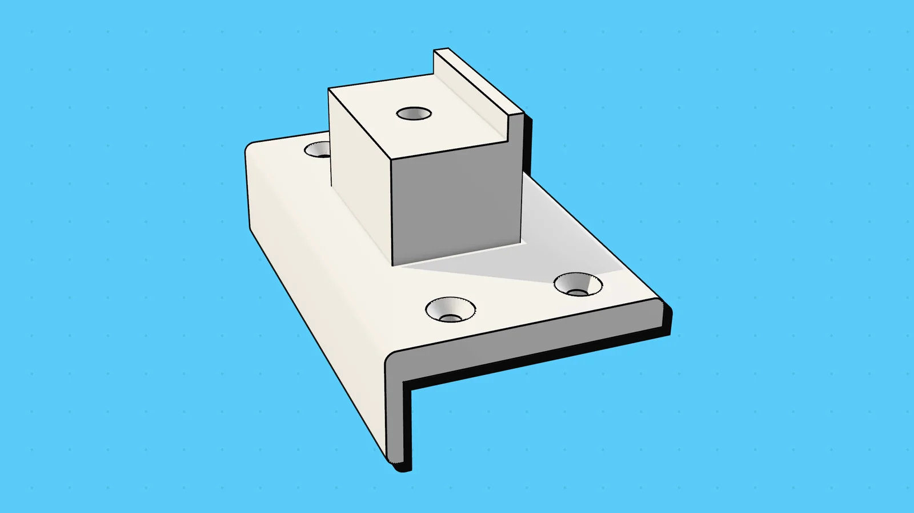
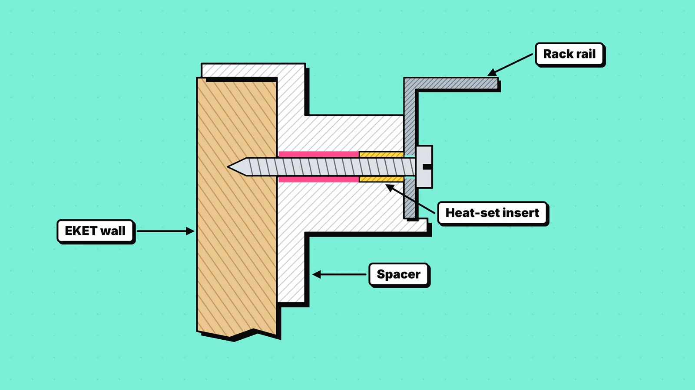
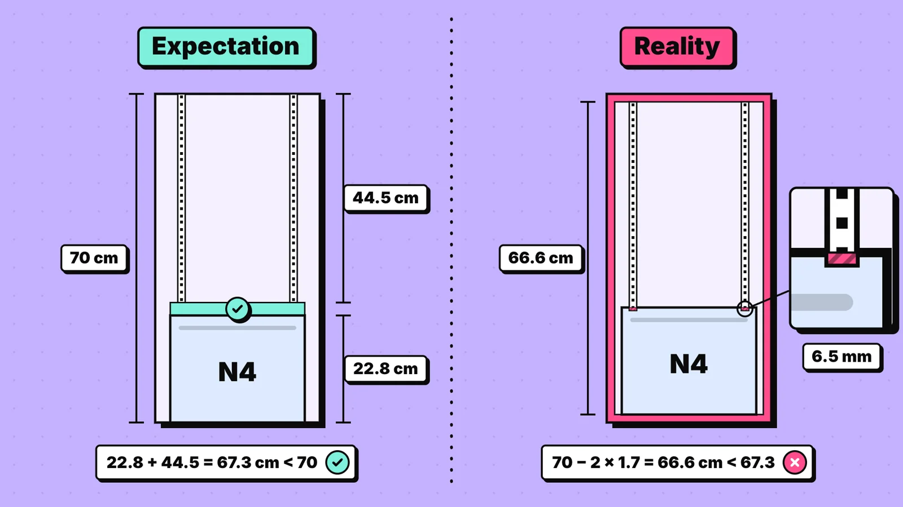
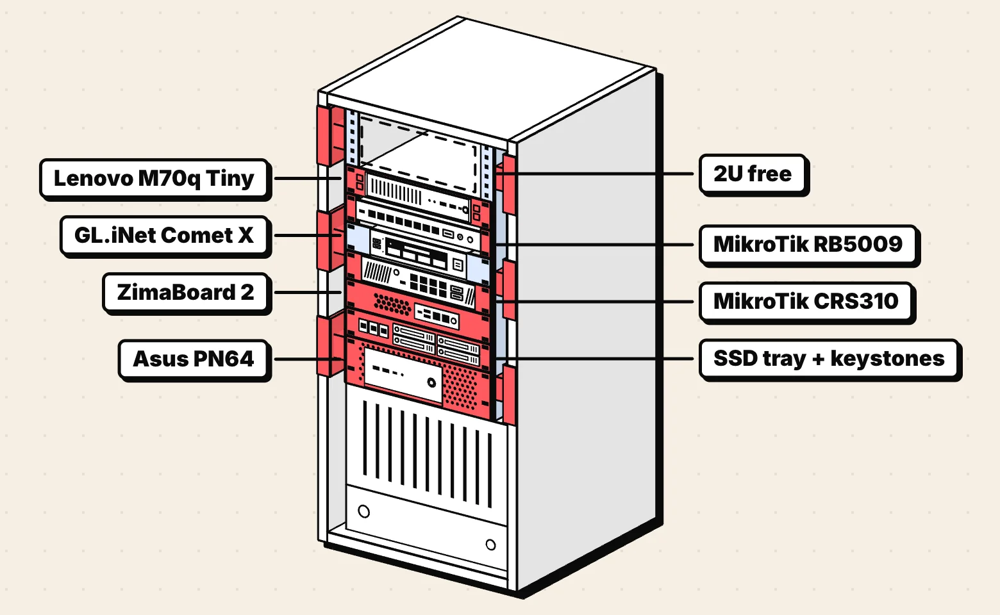
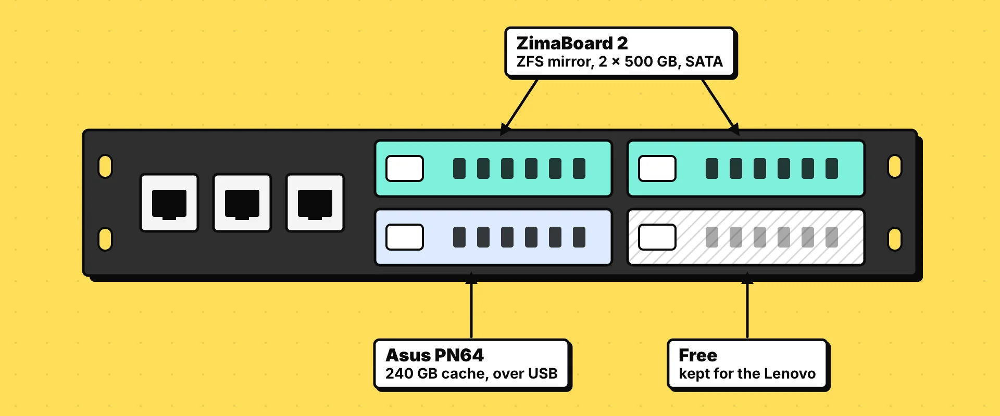
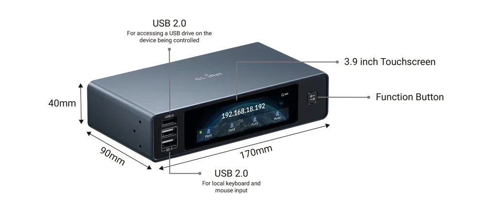
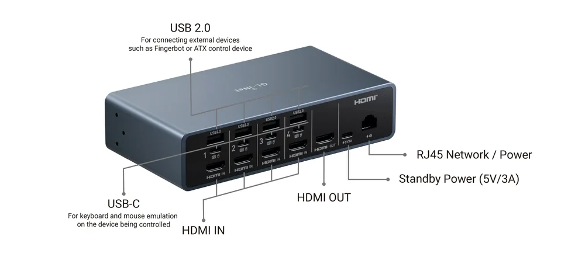
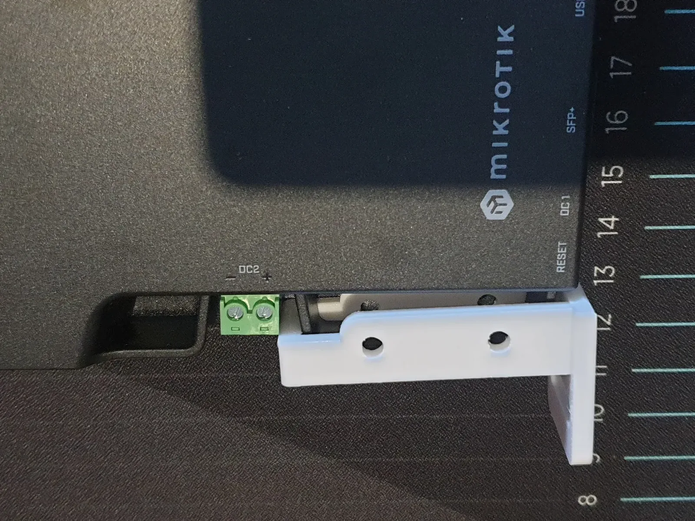
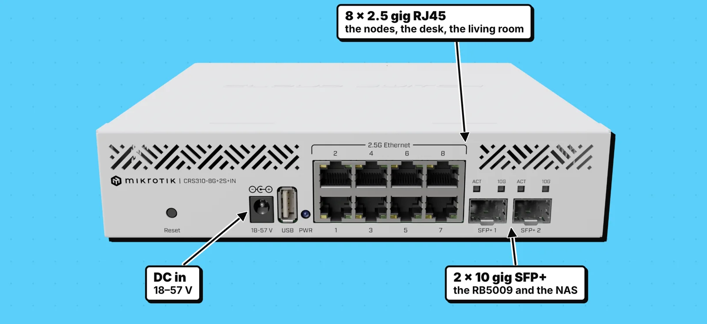

The 19-inch rack is the default answer to "where do my servers live?", and if you have a garage or a basement to hide it in, it's great. In an apartment, it's big and it looks out of place. So I built a 10-inch mini rack into an IKEA EKET cabinet instead. All of my always-on, home-production stuff now lives in it, and the old 19-inch rack is going back to my parents' place as an on-demand colo for off-site backups and lab gear.

This post goes with the [YouTube video](https://www.youtube.com/watch?v=8drAH3K83HU). It's less story and more reference: the numbers, every part and where to get it, the printed models, and a few things that didn't make the cut.

> GL.iNet sent me the Comet X and mikrotik.ro sent me the CRS310 for free, and I get to keep them. Neither paid me, had any editorial input, or saw the video or this post before they went live. Everything else in the rack is hardware I already had.
{.prompt-info}

## The Cabinet

The cabinet is an [IKEA EKET with one door and one shelf](https://www.ikea.com/se/en/p/eket-cabinet-w-door-and-1-shelf-white-90333938/), the 35×35×70 cm one, stood on its end with the door left off. The article number changes with the colour and the country (903.339.38 is the white one), so search your local IKEA for "EKET 35x35x70". A second, square EKET sits on top as a shelf for trinkets, and some [printed feet](https://makerworld.com/en/models/1608261-height-adjustable-leg#profileId-1696165) keep it off the floor, away from dust and mops.

I picked the tall one because I wanted about ten units of rack space with my NAS underneath. On paper, it fits exactly that. More on "on paper" in a minute.

## Spacers: Making the Rails Fit

I got a pair of 10U rack rails ([König & Meyer 28410](https://www.muziker.ro/konig-meyer-28410-single-rack-rail-black)) from a local music store (they're the same rails used for audio gear). The problem is that the EKET is too wide for them. The walls are about 17 mm thick, so the inside is roughly 316 mm wall to wall, and a 10-inch rack's rails sit about 256 mm apart. That leaves about **30 mm of gap on each side**, so the rails can't just screw into the walls.

So I designed spacers. Before this I'd never done any 3D modelling. I started in Onshape, then moved to SolidCraft to have something that runs locally instead of in a browser tab. I briefly tried FreeCAD too, but it didn't click for me.

- **A wide base with four screws into the side wall.** Everything in the rack hangs off the rails, and the rails hang off these spacers, so I was worried about them sagging or tearing out of the EKET's particleboard over time. The wide base spreads that load over more of the wall and the four screws share it, so I overbuilt them on purpose.
- **A lip along the front edge** of the EKET, so every spacer lines up with the others.
- **A rail stop:** a second lip on the platform the rail mounts to. The rail butts up against it and ends up flush with the front of the cabinet.

The first version had neither lip. Every spacer sat a little differently, the errors added up, and the rails went in crooked.



Through the middle of each spacer is a hole for a long wood screw. It goes through the rail and the spacer and straight into the EKET's wall, so the rail is really screwed into the cabinet, and the spacer just holds it in place. The top half of that hole has a heat-set insert that matches the wood screw's thread (it shouldn't work, but it does), and the bottom half is slightly narrower, so the screw bites into the plastic. Nothing works loose over time.

There are six of them, three per side, in plain white PLA with 15% gyroid infill. The sides are left open for airflow, for now.

## The Rack Math I Got Wrong

IKEA says the EKET is 70 cm tall. Jonsbo says the N4 is 22.8 cm. Ten rack units are 44.45 cm. That adds up to 67.25 cm, so it fits, right?

Except the 70 cm is on the outside. Take off two 17 mm panels and the inside is 66.6 cm, which leaves me about **6.5 mm short**.

The fix was a hacksaw. I cut the bottom third of the lowest unit off both rails, which leaves **9.66U**. That's also why the PN64 mount at the bottom of the rack is 1.66U tall instead of 2U.

## What's in the Rack

From the top: 2U kept free, then the Lenovo, the RB5009 and the patch panel (half a unit each), the Comet X, the CRS310, the ZimaBoard, the SSD tray and the Asus, with the NAS on the floor of the cabinet. The mounts for all of them are in [Printed Parts](#printed-parts), and the hardware is in the [Parts List](#parts-list).

<!-- TODO: swap this drawing for a well-lit photo of the real rack, with the same name plates on top. -->

### The Nodes

Every node gets the same recipe: [Talos Linux](https://www.youtube.com/watch?v=4_U0KK-blXQ) boots from a small drive, and etcd gets its own Intel Optane. On consumer SSDs I kept getting etcd disk latency warnings. Since moving to Optane, I haven't seen a single one. 16 GB Optane drives are cheap on [AliExpress](https://a.aliexpress.com/_EvzJUKE).

- **Lenovo ThinkCentre M70q Tiny** — Pentium Gold G6400T (2 cores, 4 threads), 16 GB DDR4, a 120 GB SATA SSD for Talos and a 16 GB Optane for etcd. It will run my **public** cluster, for anything that faces the internet, isolated from the rest of the network. For now it's racked and wired, but not running anything yet.
- **ZimaBoard 2** (16 GB) — Intel N150, Talos on the 64 GB onboard eMMC, the Optane on an M.2 adapter in the PCIe slot, and both SATA ports going to two 500 GB SSDs in the tray, in a ZFS mirror. It will run my **utils** cluster: monitoring and alerting for the MikroTik gear and TrueNAS, a pull-through container registry cache, and LDAP plus Keycloak for auth, the things most of my other infrastructure depends on. Right now those still run as Docker containers on the NAS, managed through Terraform. Once they move here, FluxCD manages them like everything else, which is a lot nicer. For now, the board is racked but not running anything yet. More on this board in [my RouterOS on a ZimaBoard 2 post]().
- **Asus PN64** — i7-12700H (14 cores, 20 threads), 32 GB DDR5 on a single stick, a 500 GB SATA SSD and the Optane in the NVMe slot. About 100 GB of the SSD goes to Talos and the other 400 GB to local app data, which is plenty since bulk storage comes over NFS from the NAS. There's also a 240 GB SSD in the shared tray, over a USB-to-SATA adapter, for cache and anything else I wouldn't mind losing. It runs my **main** cluster (Jellyfin, Immich, Navidrome and friends) and replaces my old Ryzen box. The migration was the easy part, thanks to [VolSync](https://github.com/backube/volsync) and [Flux](https://fluxcd.io/): I backed up the old cluster, bootstrapped the new one, and everything restored itself.

> 🎁 Want a ZimaBoard 2? Get one through [my affiliate link](https://shop.zimaspace.com?sca_ref=12733878.lOmnN3gX3AgmQn) and use code **`mirceanton_15`** for a discount. I get a small commission at no extra cost to you.
{.prompt-tip}

### The SSD Tray

The hot-swap tray is shared. The top two bays are the ZimaBoard's ZFS mirror, the bottom left is the Asus's cache drive over USB, and the fourth bay is empty for now, in case the Lenovo ever needs local storage.

### The Asus PN64 Mount

This is the one device mount I designed myself. It has a bed with holes for the PN64's feet, so it doesn't slide when I press the power button or plug something in or out, a holder for the power brick on the side, and cable tie holes at the back.



It was also the hardest print in the build. No orientation worked without supports, and it fell over mid-print a couple of times, so I split it with a dovetail joint in OrcaSlicer and printed it in two halves. It's held up fine so far 🤞

### The NAS

The Jonsbo N4 sits at the very bottom, under the rails. It's the same Supermicro X11SSL-F, Xeon E3-1230 v6 and 64 GB of ECC RAM from my old NAS, moved into the N4 that used to house my off-site backup (more on that in my [TrueNAS backups video](https://www.youtube.com/watch?v=AP5rfsOjjbo)). For storage:

- 5× 1.92 TB SATA SSDs, in a 3D-printed tray in the N4's non-hot-swap drive cage
- 3× 4 TB HGST drives for bulk storage
- 1× 1 TB HDD for torrent downloads
- 1× 1 TB SSD for my Steam library, I guess 🤷 (I'll find a use for it)

### KVM: GL.iNet Comet X

This 1U slot used to hold a plate with eight keystones and a [JetKVM](https://jetkvm.com/). The JetKVM is great, but it only talks to one machine at a time, so switching from the Asus to the Lenovo meant walking over to the rack, unplugging and replugging cables (or rather... out and in) and waiting for it to boot.

The GL.iNet Comet X (GL-RM4PE) connects to four machines at once, with four HDMI inputs and four USB-C ports. Right now the Asus, the ZimaBoard and the Lenovo are plugged into it. Switching is a click in the web UI, or the button on the front if you're standing at the rack, and the small touchscreen shows the status and IP address. There's also an HDMI and USB output for a local monitor and keyboard, and it can run off PoE. It's one machine at a time, not four side by side, but that's all I need.

> **A security note before you buy one.** On November 20, 2026, GL.iNet found that attackers had used a flaw in GoodCloud, its remote management service, to install malware on some of its routers and KVMs. The Comet X is on the list of KVMs that got security firmware. If you own any GL.iNet device, update it to the security firmware; for the Comet X (GL-RM4PE) that's 1.10.3 or newer. If it was ever connected to GoodCloud, follow the recovery steps in [GL.iNet's security notice](https://www.gl-inet.com/en-us/blogs/blog/glinet-security-notice-2026-11-20): reinstall the firmware without keeping settings, and replace any passwords and keys it held. For a KVM, also check the computers it's plugged into. Some KVMs turn the cloud service on before you link an account, so never having used GoodCloud doesn't prove the device never connected.
>
> None of that changes my mind about the hardware itself. It's very capable, and in my opinion it's worth the money, as long as you do your security right.
>
> So take this as a reminder: if a device doesn't need the internet, don't give it any. A KVM has full control of every machine it's plugged into, so keep it on a network segment that can't reach out, and get to it over your own VPN instead of a vendor's cloud.
{.prompt-warning}

<!-- Two separate callouts: the warning, then the affiliate tip. -->

> 🎁 Still want a Comet X? Get it through [my GL.iNet affiliate link](https://www.awin1.com/cread.php?awinmid=80509&awinaffid=3167224). I get a small commission at no extra cost to you.
{.prompt-tip}

### Network: RB5009 + CRS310

The [MikroTik RB5009](https://mikrotik.com/product/rb5009ug_s_in) is my router. Its mount is my remix of [mseidler's Printables design](https://www.printables.com/model/1236191-mikrotik-rb5009-10-inch-rack-mount): the original clashed with the DC terminals on the router's side, so it wouldn't sit right.

<!-- TODO: add a photo of the RB5009 in its printed rack ears here. -->

The [CRS310-8G+2S+IN](https://mikrotik.ro/Switch-uri/400-mikrotik-crs310-8g2sin.html) is the new switch, courtesy of MikroTik Romania. It has eight 2.5 gig ports and two 10 gig SFP+ ports. More and more devices come with faster-than-gigabit networking now, but most of them stop at 2.5 gig, not 10. And 10 gig has its own downsides: 10 gig copper gets quite toasty, and fiber is a bit more of a hassle to run and manage. In my opinion, a multi-gig switch like this is the best of both worlds: faster than gigabit, with fewer of 10 gig's drawbacks.

Together with the RB5009, it replaces both of my old switches. The CRS310 more or less takes over from my [CRS317](https://mikrotik.com/product/crs317_1g_16s_rm): it's the faster-than-gigabit backbone, with one 10 gig SFP+ port going up to the router and the other to my storage server. The RB5009's remaining gigabit ports take over from my [CRS326](https://mikrotik.com/product/CRS326-24G-2SplusRM), as a sort of management network: the NAS's IPMI and management ports, the KVM, and the Lenovo.

## The Back Panel and Cooling

The airflow direction picked itself. Almost everything in here either pulls air front to back or is passively cooled, so the whole rack does front to back too. With the stock back on, though, the hot air has nowhere to go, and it would get very toasty in there very quickly.

My first fix was cutting fan holes into the EKET's stock back panel. That solved the air, but it created a new problem: with a solid back, how do I plug and unplug cables back there? Cabling was a pain, so I scrapped it and designed my own back panel.



- **A printed frame** slides into the groove meant for the original back, with lots of magnet inserts.
- **Six panels** stick to it magnetically, so they come off when I need to get to the cables and snap back on after.
- **Fans:** a [Noctua NF-A12x25](https://www.noctua.at/en/products/nf-a12x25-pwm) at the top and bottom, and an [NF-A8](https://www.noctua.at/en/products/nf-a8-pwm) in the middle, all exhausting out the back.
- **Cutouts:** the middle holds the Ethernet keystones and a 12 V pass-through, and there are cable pass-throughs built in.
- **Fan control:** a PWM controller from AliExpress with a knob, so it's manual. I set it once to balance airflow and noise and left it.

The weak spot is the magnets. If I shake the cabinet too hard, a panel falls off. The next version gets alignment pegs, screw points or stronger magnets.

## Power

For now, power is a basic power strip bolted to the inside wall. I'd like to replace it with a custom PDU (see below).

## Printed Parts

| Part | Designer | Where |
| --- | --- | --- |
| Rail spacers (×6) | Me | <!-- TODO --> Coming soon |
| Back panel (frame, 6 panels, couplers) | Me | <!-- TODO --> Coming soon |
| Asus PN64 mount (1.66U) | Me | <!-- TODO --> Coming soon |
| Lenovo ThinkCentre Tiny mount | Tim (Timmi101) | [MakerWorld](https://makerworld.com/en/models/1945283-lenovo-thinkcentre-tiny-10-rack-mount-m720q#profileId-2280061) |
| ZimaBoard 2 mount | DesignBot | [MakerWorld](https://makerworld.com/en/models/1927437-zimaboard-2-10-rack-pcie-dual-nvme-m-2-ssd-card#profileId-2068736) |
| 1U 4× 2.5" bay + 3 keystones | Nautilus Forge | [MakerWorld](https://makerworld.com/en/models/2897784-10-inch-rack-1u-4x-2-5-inch-hdd-3x-keystones#profileId-3238822) |
| RB5009 10-inch mount | Me, remixed from mseidler's Printables model | <!-- TODO --> Coming soon; original on [Printables](https://www.printables.com/model/1236191-mikrotik-rb5009-10-inch-rack-mount) |
| MikroTik 10-inch rack ears (CRS310) | klayf | [MakerWorld](https://makerworld.com/en/models/1190849-mikrotik-10-inch-mini-rack-ears-rmk-2-10-alternati#profileId-1202558) |
| Half-U 7-port keystone patch panel | Nautilus Forge | [MakerWorld](https://makerworld.com/en/models/2875409-10-inch-rack-patch-panel-keystone-bonanza#profileId-3210706) |
| Height-adjustable feet | Ondra7 | [MakerWorld](https://makerworld.com/en/models/1608261-height-adjustable-leg#profileId-1696165) |
| 8-port patch panel + JetKVM (the old 1U plate) | MrVue | [MakerWorld](https://makerworld.com/en/models/1298168-8-port-patch-panel-and-jetkvm#profileId-1329990) |

I'll publish my own designs as STL and 3MF files, most likely on MakerWorld, and link them here once they're up.

## Parts List

| Part | Link |
| --- | --- |
| IKEA EKET cabinet, 35×35×70 cm (×1, plus a square one on top) | [IKEA](https://www.ikea.com/se/en/p/eket-cabinet-w-door-and-1-shelf-white-90333938/) |
| 10U rack rails (×2, sold singly) | [Muziker](https://www.muziker.ro/konig-meyer-28410-single-rack-rail-black) (König & Meyer 28410, the ones I used), or [Thomann](https://www.thomann.de/intl/adam_hall_61535b10_rack_strip_10u_blk.htm) (Adam Hall 61535B10, a similar one that ships internationally) |
| Jonsbo N4 | [Jonsbo](https://www.jonsbo.com/en/products/N4Black.html) |
| MikroTik RB5009UG+S+IN | [MikroTik](https://mikrotik.com/product/rb5009ug_s_in) |
| MikroTik CRS310-8G+2S+IN | [mikrotik.ro](https://mikrotik.ro/Switch-uri/400-mikrotik-crs310-8g2sin.html) |
| GL.iNet Comet X (GL-RM4PE) | [GL.iNet (affiliate)](https://www.awin1.com/cread.php?awinmid=80509&awinaffid=3167224) |
| ZimaBoard 2 | [ZimaSpace (affiliate)](https://shop.zimaspace.com?sca_ref=12733878.lOmnN3gX3AgmQn) |
| Intel Optane 16 GB M.2 | [AliExpress](https://a.aliexpress.com/_EvzJUKE) |
| 2.5" SSD caddies for the hot-swap tray | [AliExpress](https://a.aliexpress.com/_ExCJPnu) |
| PWM fan controller with a knob | [AliExpress](https://a.aliexpress.com/_EzrWZJC) |
| Noctua NF-A12x25 PWM (×2) | [Noctua](https://www.noctua.at/en/products/nf-a12x25-pwm) |
| Noctua NF-A8 PWM | [Noctua](https://www.noctua.at/en/products/nf-a8-pwm) |

## What's Next

In no particular order, here are some of the improvements I'd like to make to this project in the future:

- Design a custom 10-inch PDU, to replace the power strip, with both AC and DC outputs.
- Find a small UPS. When the power goes out, the NAS should shut down cleanly and the network should stay up for as long as possible.
- Add a stats display in the empty top 2U.
- Design/re-print the back panel to be a bit sturdier, with support pegs, screw points or stronger magnets.
- Design custom side face plates, to push air through the devices instead of around them, and maybe double as a built-in patch panel.

Running your homelab in a mini rack, or planning to? Would you buy one off the shelf or build it yourself? Let me know in the comments.

---

📹 [Watch Video](https://www.youtube.com/watch?v=8drAH3K83HU)
{.center}


